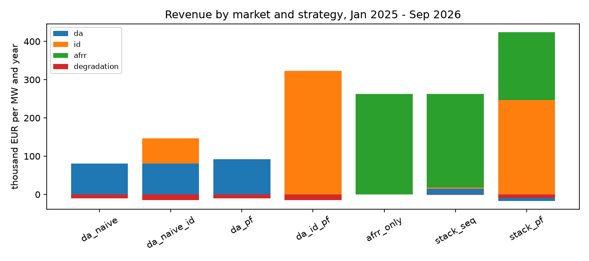
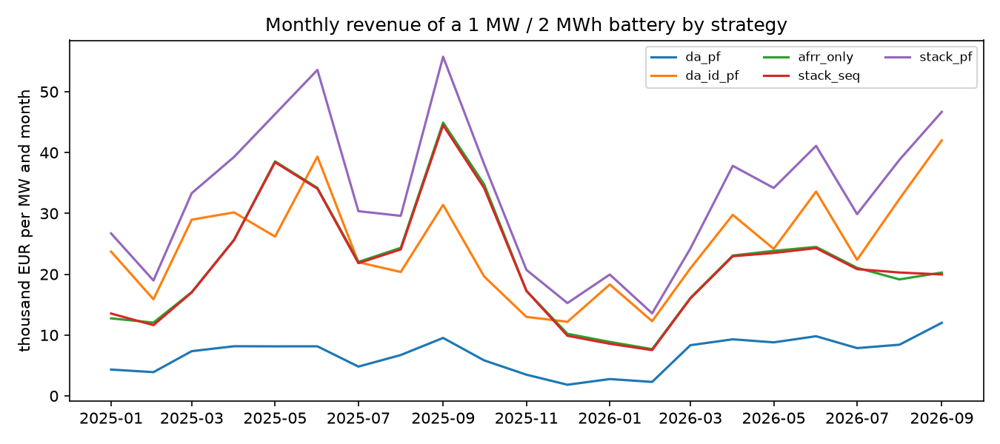
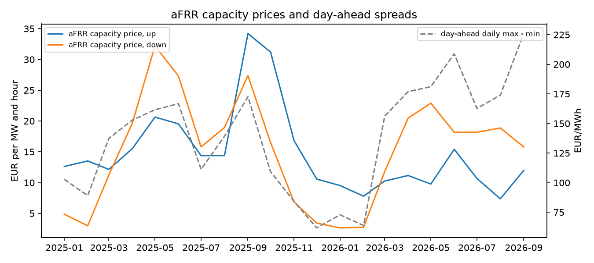

# de-battery-multimarket

How much can a battery earn in Germany when it combines the aFRR capacity market, the day-ahead
auction and intraday trading, and how much of that survives when decisions are taken in the order of
the real markets with forecasts instead of hindsight? A daily mixed-integer model of a 1 MW / 2 MWh
battery on public market data, January 2025 to September 2026 (638 days).

Builds on the day-ahead battery models of
[de-power-market-ppa](https://github.com/michaelserikov/de-power-market-ppa) (v0.3 arbitrage, v0.8
scheduling under uncertainty) and adds the balancing capacity and intraday markets.

## Results (thousand EUR per MW and year, 1 MW / 2 MWh, 88% round trip)

| Strategy | Day-ahead | Intraday | aFRR capacity | Degradation | **Total** | Cycles/day |
|---|---|---|---|---|---|---|
| Day-ahead on a naive forecast | 80.5 | | | -10.7 | **69.8** | 1.5 |
| ... plus intraday re-optimisation | 80.5 | 65.7 | | -14.9 | **131.4** | 2.0 |
| Day-ahead, perfect foresight | 91.8 | | | -10.6 | **81.2** | 1.5 |
| aFRR capacity only (1 MW up and down) | | | 262.7 | | **262.7** | 0 |
| Sequential stacking with forecasts | 14.3 | 4.2 | 244.6 | -1.7 | **261.3** | 0.2 |
| Stacking, perfect foresight (upper bound) | -16.9 | 246.6 | 177.6 | -9.7 | **397.6** | 1.3 |

Findings:

- **aFRR capacity dominates.** Selling the full power as aFRR capacity in both directions earned
  about 263 thousand EUR per MW and year, more than three times day-ahead arbitrage (70 to 81).
  The value is falling: 294 in 2025, 220 (annualised) in January to September 2026, as monthly mean
  upward capacity prices fell from 12 to 34 EUR/MW/h in 2025 to 7 to 15 in 2026.
- **Downward aFRR follows the solar day.** Downward capacity prices peak in the blocks between 08:00
  and 20:00 from April to September (monthly means across all blocks up to 32 EUR/MW/h), when surplus solar makes
  absorbing energy valuable, and move with day-ahead spreads (figure below).
- **Forecasts decide whether stacking pays.** With yesterday's capacity prices and a naive price
  forecast, the sequential strategy keeps about 0.9 MW in reserve on average and earns 261, the same
  as selling aFRR capacity alone: once the reserve is committed, the remaining day-ahead and intraday
  trades add little. With perfect foresight stacking reaches 398, so the value of better forecasts
  and bidding is about a third of the attainable revenue (sequential = 66% of the bound).
- **The reserve duration rule matters.** If each reserved MW must be deliverable for 2 hours instead
  of 1, sequential stacking falls from 285 to 211 (every 7th day); 0.5 hours raises it to 289.
- **Intraday re-optimisation of a day-ahead schedule** roughly doubles the trading revenue (70 to
  131), but this uses realised ID-AEP prices and is optimistic (see limitations).

The day-ahead perfect-foresight result for 2025 (72.3) matches the arbitrage model of
de-power-market-ppa v0.3 for the same battery and year.





## Model

One mixed-integer linear program per local day (SciPy, HiGHS), 24 hours and six four-hour aFRR blocks:

- **Decisions:** aFRR capacity up and down per block, the day-ahead position per hour, the physical
  charge and discharge per hour; the difference between the physical schedule and the day-ahead
  position is traded intraday at the ID-AEP price.
- **Physics:** power 1 MW, energy 2 MWh, round-trip efficiency 88%, a binary per hour forbids
  charging and discharging at once, the day starts and ends half full, degradation cost 10 EUR per
  MWh discharged.
- **Reserve:** charging plus downward reserve and discharging plus upward reserve stay within the
  power rating in every hour of a block; the state of charge keeps tau hours of energy for each
  reserved MW (tau = 1 h, sensitivity 0.5 and 2 h).
- **Deliverable day-ahead plan:** the day-ahead position must itself be a feasible schedule of the
  battery, so the model cannot sell energy it could not deliver and buy it back intraday.
- **Revenue:** day-ahead price x position + ID-AEP x intraday trade + capacity price x reserved MW x
  4 h - degradation.

Strategies: perfect foresight for each market and their combination (upper bounds), and a sequential
strategy in the order of the real markets: aFRR capacity auction on yesterday's capacity prices and a
naive price forecast (d-1, or d-7 for Monday, Saturday, Sunday), then the day-ahead schedule on the
naive forecast with the reserve fixed, then intraday re-optimisation with reserve and day-ahead
position fixed.

```bash
pip install -e ".[test]"
export NTP_CLIENT_ID=... NTP_CLIENT_SECRET=...   # free netztransparenz.de WebAPI client
python -m bessmm.run                              # about 10 minutes; writes results/ and figures/
pytest -q                                         # 8 offline tests
```

## Limitations

- **Price-taker, capacity paid at the German average accepted price.** The aFRR capacity market is
  pay-as-bid; a real bidder earns its own bid and may not be accepted. Revenue from aFRR activation
  energy and its effect on the state of charge are not modelled.
- **ID-AEP is not a tradable price.** It is the volume-weighted average of all intraday trades in a
  quarter hour; re-optimising at realised ID-AEP assumes the battery could trade at that average with
  hindsight within the day. Intraday results are therefore optimistic, and the perfect-foresight
  bounds mostly measure hindsight on the day-ahead to intraday spread.
- Hourly resolution: the quarter-hour day-ahead products since October 2025 and quarter-hour ID-AEP
  are averaged to hours. Each day is optimised separately; no FCR, no grid fees, no capex.
- Illustrative parameters and a research study on public data, not a business case or a trading system.

## Data

- Day-ahead prices: SMARD (Bundesnetzagentur | SMARD.de), CC BY 4.0.
- ID-AEP: netztransparenz.de WebAPI of the German TSOs.
- aFRR capacity auction results: regelleistung.net (daily results overview, German average capacity price).

Raw data are downloaded on first use and not committed.

## Tests

`pytest -q` runs 8 offline tests: day-ahead arbitrage charges in cheap and discharges in expensive
hours, flat prices give no trades, aFRR-only sells the full power, high capacity prices crowd out
trading, fixed decisions are respected and revenue adds up, stacking with perfect foresight bounds
every other strategy, the day-ahead plan cannot sell undeliverable energy, and the parsers and the
local-day conversion across a clock change.
